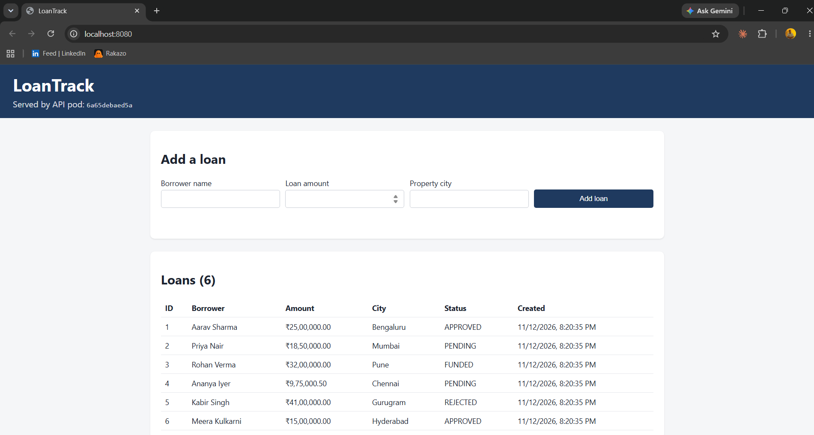
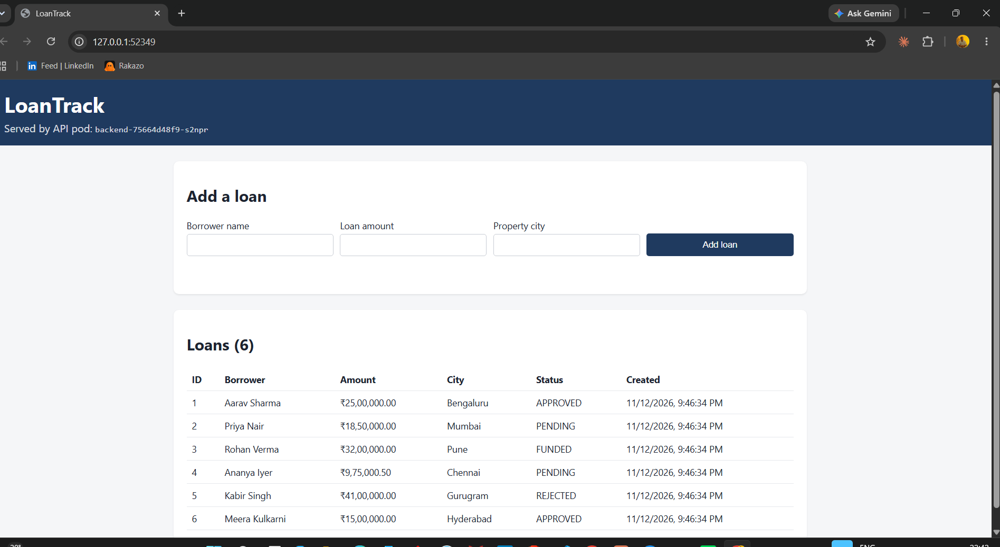
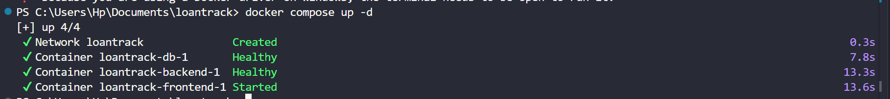
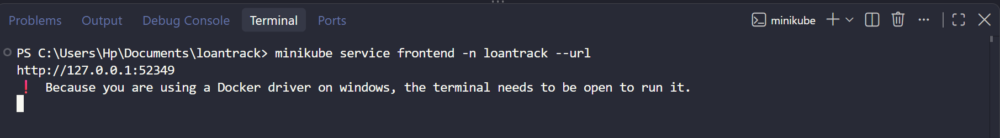

# Evidence

Commands and outputs requested in Parts B, C and D, captured on 2026-11-12 on
Windows 11 (Git Bash), Docker Desktop 29.8.1, minikube v1.39.0 / Kubernetes v1.37.0.
Long outputs are trimmed with `...`; nothing else is edited.

## Screenshots

| Docker Compose (`http://localhost:8080`) | Kubernetes (minikube service URL) |
|---|---|
|  |  |
| Served by `6a65debaed5a`: the Compose backend container ID | Served by `backend-75664d48f9-s2npr`: a Kubernetes pod name |

Terminal captures of the two start-up commands (the same output is pasted as text below):

| `docker compose up -d` | `minikube service frontend -n loantrack --url` |
|---|---|
|  |  |

---

## Part B: Docker

### Acceptance: clean clone -> working app

```
$ git clone https://github.com/Nitish0223/loantrack.git && cd loantrack
$ cp .env.example .env
$ docker compose up -d
 ...
 Container loantrack-db-1 Started
 Container loantrack-db-1 Waiting
 Container loantrack-db-1 Healthy
 Container loantrack-backend-1 Starting
 Container loantrack-backend-1 Started
 Container loantrack-backend-1 Waiting
 Container loantrack-backend-1 Healthy
 Container loantrack-frontend-1 Starting
 Container loantrack-frontend-1 Started

$ docker compose ps
SERVICE    STATUS                     PORTS
backend    Up 6 seconds (healthy)     8080/tcp
db         Up 12 seconds (healthy)    5432/tcp
frontend   Up (healthy)               0.0.0.0:8080->8080/tcp, [::]:8080->8080/tcp
```

Only the frontend publishes a port; `db` and `backend` are reachable only on the
`loantrack` network (`docker ps` shows `loantrack-db-1 5432/tcp` with no host binding).

### Image sizes (backend < 300 MB)

```
$ docker images
REPOSITORY            TAG     SIZE
loantrack-db          1.0.0   393MB
loantrack-frontend    1.0.0   72.2MB
loantrack-backend     1.0.0   230MB
```

### Non-root users

```
$ docker compose exec frontend whoami
nginx
$ docker compose exec backend whoami
node
$ docker compose exec db whoami
postgres
```

### Layer cache: a source change reuses the dependency layer

After appending a comment to `backend/src/app.js`:

```
$ docker compose build --progress=plain backend
#8 [deps 3/4] COPY package.json package-lock.json ./
#8 CACHED
#9 [deps 4/4] RUN npm ci --omit=dev
#9 CACHED
#10 [runtime 3/5] COPY --from=deps --chown=node:node /app/node_modules ./node_modules
#10 CACHED
#11 [runtime 4/5] COPY --chown=node:node package.json ./
#11 CACHED
#12 [runtime 5/5] COPY --chown=node:node src ./src      <- only this layer rebuilt
```

### Frontend config is validated at build time

```
$ docker build --no-cache --progress=plain -t loantrack-frontend:1.0.0 frontend
#6 [config-check 2/3] COPY nginx/default.conf.template /etc/nginx/templates/default.conf.template
#7 0.756 nginx: the configuration file /etc/nginx/nginx.conf syntax is ok
#7 0.760 nginx: configuration file /etc/nginx/nginx.conf test is successful
#8 [runtime 2/4] COPY --from=config-check /tmp/nginx-config-ok /etc/nginx/config-validated
```

---

## Part C: Database and three-tier connectivity

### Migration and seed applied automatically on first start

```
$ docker logs <db container>
/usr/local/bin/docker-entrypoint.sh: running /docker-entrypoint-initdb.d/001_create_loans_table.sql
CREATE TABLE
/usr/local/bin/docker-entrypoint.sh: running /docker-entrypoint-initdb.d/002_seed_loans.sql
INSERT 0 6
```

### Backend started before the database: retries with backoff, then recovers

Database stopped, backend restarted, database started again:

```
$ docker compose stop db
$ docker compose restart backend
$ docker compose logs --no-log-prefix backend
[api] 8a5165b658cc listening on port 8080
[db] attempt 1 failed: Connection terminated due to connection timeout - retrying in 500ms
[db] attempt 2 failed: Connection terminated due to connection timeout - retrying in 1000ms
$ docker compose start db
$ docker compose logs --no-log-prefix backend
[db] connected to db:5432 (attempt 3)
```

The process never exits: `waitForDatabase()` retries with a doubling delay capped at 10s.

### /readyz fails when the database is down, /healthz does not

```
$ docker compose stop db
$ curl -s -w " [%{http_code}]\n" localhost:8080/api/healthz
{"status":"ok","pod":"8a5165b658cc"} [200]
$ curl -s -w " [%{http_code}]\n" localhost:8080/api/readyz
{"status":"not ready","error":"Connection terminated due to connection timeout","pod":"8a5165b658cc"} [503]
```

### A loan added in the UI is in the database

Added through the UI path (`POST /api/loans` via nginx), then queried in the db container:

```
$ curl -s -X POST -H 'content-type: application/json' \
    -d '{"borrower_name":"UI Test Docker","loan_amount":2750000,"property_city":"Bengaluru"}' \
    localhost:8080/api/loans
{"pod":"8a5165b658cc","loan":{"id":7,"borrower_name":"UI Test Docker","loan_amount":"2750000.00","property_city":"Bengaluru","status":"PENDING","created_at":"2026-11-12T14:46:56.043Z"}}

$ docker compose exec db psql -U loantrack -d loantrack \
    -c "SELECT id, borrower_name, loan_amount, property_city, status FROM loans WHERE borrower_name='UI Test Docker';"
 id | borrower_name  | loan_amount | property_city | status
----+----------------+-------------+---------------+---------
  7 | UI Test Docker |  2750000.00 | Bengaluru     | PENDING
(1 row)
```

### Persistence: down/up keeps data, down -v resets it

```
$ docker compose exec db psql -U loantrack -d loantrack -tAc "SELECT count(*) FROM loans;"
7
$ docker compose down && docker compose up -d
$ docker compose exec db psql -U loantrack -d loantrack -tAc "SELECT count(*) FROM loans;"
7
$ docker compose down -v
 Volume loantrack-pgdata Removed
$ docker compose up -d
$ docker compose exec db psql -U loantrack -d loantrack -tAc "SELECT count(*) FROM loans;"
6
```

`down -v` deleted the `loantrack-pgdata` volume, so the next start ran the init
scripts again on an empty data directory and only the 6 seed rows came back.

---

## Part D: Kubernetes (minikube)

### Deploy

```
$ ./scripts/deploy.sh
...
==> Applying namespace and database secret
namespace/loantrack created
secret/loantrack-db-secret created
==> Applying manifests
configmap/loantrack-config created
service/backend created
service/frontend created
service/postgres created
deployment.apps/backend created
deployment.apps/frontend created
statefulset.apps/postgres created
==> Waiting for rollouts
partitioned roll out complete: 1 new pods have been updated...
deployment "backend" successfully rolled out
deployment "frontend" successfully rolled out
```

Second run (idempotency):

```
$ ./scripts/deploy.sh
namespace/loantrack unchanged
secret/loantrack-db-secret unchanged
configmap/loantrack-config unchanged
service/backend unchanged
service/frontend unchanged
service/postgres unchanged
deployment.apps/backend unchanged
deployment.apps/frontend unchanged
statefulset.apps/postgres configured     # kubectl diff -k k8s/ is empty, no restart (see README)
```

### Open the frontend

```
$ minikube service frontend -n loantrack --url
http://127.0.0.1:51750
! Because you are using a Docker driver on windows, the terminal needs to be open to run it.
$ curl -s -o /dev/null -w "%{http_code}\n" http://127.0.0.1:51750/
200
```

### DNS: backend pod -> database Service

```
$ kubectl exec -n loantrack backend-85cf5cdb49-8vnzn -- nslookup postgres.loantrack.svc.cluster.local
Server:		10.96.0.10
Address:	10.96.0.10:53

Name:	postgres.loantrack.svc.cluster.local
Address: 10.104.212.172

$ kubectl exec -n loantrack backend-85cf5cdb49-8vnzn -- nc -zv postgres 5432
postgres (10.104.212.172:5432) open
```

Fully-qualified name: **`postgres.loantrack.svc.cluster.local`** (`<service>.<namespace>.svc.cluster.local`).
`10.104.212.172` is the ClusterIP of the `postgres` Service; the database has no NodePort.

### D4.1 Scale the backend to 3 replicas

```
$ kubectl scale deployment backend -n loantrack --replicas=3
deployment.apps/backend scaled
$ kubectl get pods -n loantrack -l app.kubernetes.io/name=backend
NAME                       READY   STATUS    RESTARTS   AGE
backend-85cf5cdb49-8vnzn   1/1     Running   0          10m
backend-85cf5cdb49-d4dch   1/1     Running   0          7s
backend-85cf5cdb49-thj28   1/1     Running   0          10m

$ for i in $(seq 1 9); do curl -s localhost:8081/api/loans | jq -r .pod; done | sort | uniq -c
      1 backend-85cf5cdb49-8vnzn
      5 backend-85cf5cdb49-d4dch
      3 backend-85cf5cdb49-thj28
```

(`localhost:8081` is `kubectl port-forward -n loantrack svc/frontend 8081:8080`; nginx
forwards to the `backend` Service, which load-balances across the three pods.)

### D4.2 Rolling update to :v2, then undo

```
$ docker build --build-arg APP_VERSION=v2 -t loantrack-backend:v2 backend
$ minikube image load loantrack-backend:v2
$ kubectl set image deployment/backend -n loantrack backend=loantrack-backend:v2
deployment.apps/backend image updated
$ kubectl rollout status deployment/backend -n loantrack
Waiting for deployment "backend" rollout to finish: 1 out of 3 new replicas have been updated...
Waiting for deployment "backend" rollout to finish: 2 out of 3 new replicas have been updated...
Waiting for deployment "backend" rollout to finish: 1 old replicas are pending termination...
deployment "backend" successfully rolled out
$ curl -s localhost:8081/api/loans | jq -r '.version + " " + .pod'
v2 backend-545948ddf6-29ndh
$ kubectl rollout history deployment/backend -n loantrack
REVISION  CHANGE-CAUSE
1         <none>
2         update backend image to loantrack-backend:v2

$ kubectl rollout undo deployment/backend -n loantrack
deployment.apps/backend rolled back
$ kubectl rollout status deployment/backend -n loantrack
Waiting for deployment "backend" rollout to finish: 1 out of 3 new replicas have been updated...
Waiting for deployment "backend" rollout to finish: 2 out of 3 new replicas have been updated...
Waiting for deployment "backend" rollout to finish: 1 old replicas are pending termination...
deployment "backend" successfully rolled out
$ kubectl get pods -n loantrack -l app.kubernetes.io/name=backend -o custom-columns=NAME:.metadata.name,IMAGE:.spec.containers[0].image
NAME                       IMAGE
backend-85cf5cdb49-hzh9d   loantrack-backend:1.0.0
backend-85cf5cdb49-mmjjp   loantrack-backend:1.0.0
backend-85cf5cdb49-vnplx   loantrack-backend:1.0.0
```

Traffic during both rollouts (one request every ~0.5s through the frontend):

```
status codes:  78 x 200, 0 errors
versions seen (in order): v1 ... v1 | v2 v2 v1 v1 v1 v2 ... (mixed) ... | v2 x27 | mixed | v1 ...
```

**What a user experiences mid-rollout:** no failed requests, but consecutive requests
can be served by the old or the new version until the rollout completes. This is
controlled by the Deployment's `strategy.rollingUpdate` (`maxSurge: 1`,
`maxUnavailable: 0`) together with the readiness probe, which keeps a new pod out of
the Service until `/readyz` passes.

### D4.3 Delete a backend pod: it is replaced

```
$ kubectl delete pod backend-85cf5cdb49-hzh9d -n loantrack
pod "backend-85cf5cdb49-hzh9d" deleted from loantrack namespace
$ kubectl get pods -n loantrack -l app.kubernetes.io/name=backend
NAME                       READY   STATUS    RESTARTS   AGE
backend-85cf5cdb49-lv6tc   1/1     Running   0          9s     <- replacement
backend-85cf5cdb49-mmjjp   1/1     Running   0          35s
backend-85cf5cdb49-vnplx   1/1     Running   0          43s
```

### D4.4 Delete the PostgreSQL pod: rows survive

```
$ kubectl exec -n loantrack postgres-0 -- psql -U loantrack -d loantrack -c "SELECT id, borrower_name, loan_amount FROM loans ORDER BY id;"
 id |    borrower_name     | loan_amount
----+----------------------+-------------
  1 | Aarav Sharma         |  2500000.00
  2 | Priya Nair           |  1850000.00
  3 | Rohan Verma          |  3200000.00
  4 | Ananya Iyer          |   975000.50
  5 | Kabir Singh          |  4100000.00
  6 | Meera Kulkarni       |  1500000.00
  7 | Rajiv                |   100000.00     <- added in the UI
  8 | K8s Persistence Test |  3300000.00     <- added through the API
(8 rows)

$ kubectl get pod postgres-0 -n loantrack -o jsonpath={.metadata.uid}
2665cf93-3050-4009-a316-f9e07c71139a
$ kubectl delete pod postgres-0 -n loantrack
pod "postgres-0" deleted from loantrack namespace
$ kubectl wait --for=condition=Ready pod/postgres-0 -n loantrack
pod/postgres-0 condition met
$ kubectl get pod postgres-0 -n loantrack -o jsonpath={.metadata.uid}
e917e2b8-4eca-4519-bfd2-b26e4a3bb13e        <- a new pod
$ kubectl exec -n loantrack postgres-0 -- psql -U loantrack -d loantrack -c "SELECT id, borrower_name, loan_amount FROM loans ORDER BY id;"
 ... same 8 rows ...
(8 rows)
```

### D4.5 Everything in the namespace

```
$ kubectl get all -n loantrack
NAME                           READY   STATUS    RESTARTS   AGE
pod/backend-85cf5cdb49-lv6tc   1/1     Running   0          25s
pod/backend-85cf5cdb49-mmjjp   1/1     Running   0          51s
pod/backend-85cf5cdb49-vnplx   1/1     Running   0          59s
pod/frontend-66c5c74f4-rh6mc   1/1     Running   0          12m
pod/frontend-66c5c74f4-sd9zj   1/1     Running   0          12m
pod/postgres-0                 1/1     Running   0          13s

NAME               TYPE        CLUSTER-IP       EXTERNAL-IP   PORT(S)          AGE
service/backend    ClusterIP   10.98.115.55     <none>        8080/TCP         12m
service/frontend   NodePort    10.103.43.220    <none>        8080:30080/TCP   12m
service/postgres   ClusterIP   10.104.212.172   <none>        5432/TCP         12m

NAME                       READY   UP-TO-DATE   AVAILABLE   AGE
deployment.apps/backend    3/3     3            3           12m
deployment.apps/frontend   2/2     2            2           12m

NAME                                 DESIRED   CURRENT   READY   AGE
replicaset.apps/backend-545948ddf6   0         0         0       105s
replicaset.apps/backend-85cf5cdb49   3         3         3       12m
replicaset.apps/frontend-66c5c74f4   2         2         2       12m

NAME                        READY   AGE
statefulset.apps/postgres   1/1     12m

$ kubectl get pvc,configmap,secret -n loantrack
NAME                                      STATUS   VOLUME                                     CAPACITY   ACCESS MODES   STORAGECLASS
persistentvolumeclaim/pgdata-postgres-0   Bound    pvc-3a47a3e7-a8af-40a7-86a9-6a4d3b0e5b18   1Gi        RWO            standard

NAME                         DATA   AGE
configmap/kube-root-ca.crt   1      12m
configmap/loantrack-config   8      12m

NAME                         TYPE     DATA   AGE
secret/loantrack-db-secret   Opaque   4      12m
```

The Secret showed 4 keys here because it was first created with `--from-env-file=.env`;
`deploy.sh` now creates it with only `POSTGRES_USER` and `POSTGRES_PASSWORD`.

### Teardown and redeploy from empty

```
$ ./scripts/teardown.sh --yes
namespace "loantrack" deleted
persistentvolume "pvc-3a47a3e7-a8af-40a7-86a9-6a4d3b0e5b18" deleted
Namespace loantrack and its volumes deleted. Images stay loaded in minikube for the next deploy.
$ ./scripts/deploy.sh          # real 1m2s
$ kubectl exec -n loantrack postgres-0 -- psql -U loantrack -d loantrack -tAc "SELECT count(*) FROM loans;"
6
```
