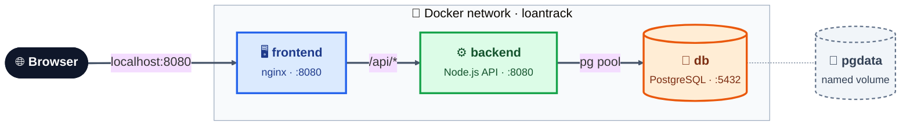
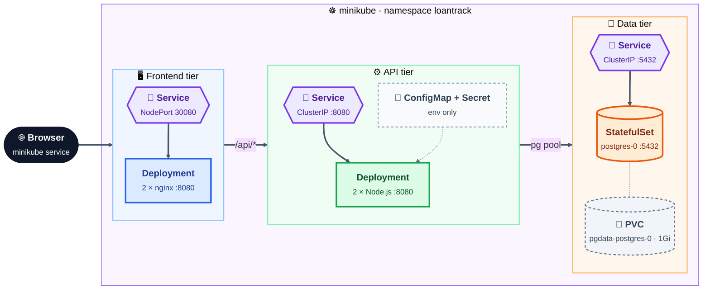

# LoanTrack

A three-tier loan tracker (static web frontend, Node.js API, PostgreSQL) that runs
under Docker Compose and on a local Kubernetes cluster (minikube), built with a
`main` / `develop` / `feature/*` Git workflow.

| Document | Contents |
|---|---|
| [EVIDENCE.md](EVIDENCE.md) | Commands and outputs for Parts B, C and D, plus UI screenshots |
| [ISSUES.md](ISSUES.md) | Real problems hit while building this: symptom, diagnosis, root cause, fix |
| [BRANCHING.md](BRANCHING.md) | Branching model used and whether I would recommend it |
| [AI_USAGE.md](AI_USAGE.md) | How AI tools were used and where they were wrong |

## Tool versions

| Tool | Version |
|---|---|
| Docker (Docker Desktop, Windows 11) | 29.8.1 |
| Docker Compose | v2 (bundled with Docker Desktop) |
| minikube | v1.39.0, docker driver, containerd 2.3.4 runtime |
| Kubernetes (minikube) | v1.37.0 |
| kubectl | v1.37.1 (Kustomize v5.8.1) |
| Backend runtime | Node.js 22.12.0 on Alpine 3.21 (Express 4, node-postgres 8) |
| Frontend | nginx 1.27.3 (`nginxinc/nginx-unprivileged`, Alpine) |
| Database | PostgreSQL 16.6 on Alpine 3.21 |

## Architecture

### Docker Compose



### Kubernetes (minikube)



### Request path

| Step | From → to | Docker Compose | Kubernetes | Port |
|---|---|---|---|---|
| 1 | Browser → frontend (nginx) | `http://localhost:8080` | `minikube service frontend -n loantrack --url` → NodePort `30080` | 8080 |
| 2 | frontend → backend | nginx proxies `/api/*` (prefix stripped) to `backend:8080` | to `backend.loantrack.svc.cluster.local:8080` (ClusterIP) | 8080 |
| 3 | backend → database | pg connection pool to `db:5432` | pg connection pool to `postgres:5432` (ClusterIP) | 5432 |
| 4 | database → disk | named volume `loantrack-pgdata` | PVC `pgdata-postgres-0` (1Gi) | – |

Traffic only flows in one direction: the browser talks to nginx, nginx to the API,
the API to PostgreSQL. **The frontend never touches the database**: it has no
driver, connection string or credential, only relative `/api/...` calls. Only the
frontend is reachable from outside; the backend and database are internal only.

<details>
<summary>Plain-text diagram</summary>

```
Docker Compose (network "loantrack", only the frontend port is published)

  Browser
    |  http://localhost:8080
    v
  frontend  nginx :8080  -- serves index.html/app.js
    |  /api/*  (prefix stripped)  ->  http://backend:8080
    v
  backend   node :8080   -- GET/POST /loans, /healthz, /readyz
    |  pg pool  ->  db:5432
    v
  db        postgres :5432  -- volume loantrack-pgdata

Kubernetes (namespace "loantrack")

  Browser
    |  minikube service tunnel  ->  NodePort 30080
    v
  Service frontend (NodePort 8080:30080)  ->  Deployment frontend (2 pods, nginx :8080)
    |  /api/*  ->  backend.loantrack.svc.cluster.local:8080
    v
  Service backend (ClusterIP 8080)        ->  Deployment backend (2 pods, node :8080)
    |  postgres:5432
    v
  Service postgres (ClusterIP 5432)       ->  StatefulSet postgres (postgres-0)
                                                 PVC pgdata-postgres-0 (1Gi)
```

</details>

## Run with Docker Compose

```bash
git clone https://github.com/Nitish0223/loantrack.git
cd loantrack
cp .env.example .env          # dummy values work locally; change the password if you like
docker compose up -d          # builds all three images on first run
```

Open **http://localhost:8080**. Then:

```bash
docker compose ps             # all three services "healthy"
docker compose logs backend   # pool connection and retry logs
docker compose down           # stop; the database volume is kept
docker compose down -v        # stop and delete the database volume (back to the 6 seed rows)
```

## Run on Kubernetes (minikube)

Prerequisites: Docker Desktop running, minikube and kubectl installed, `.env` created
(`cp .env.example .env`). From Git Bash on Windows, or any shell on macOS/Linux:

```bash
./scripts/deploy.sh
```

It starts minikube if needed, pins kubectl to the `minikube` context, builds the three
images and loads them into minikube, creates the database Secret from `.env`, applies
`k8s/` with Kustomize, waits for every rollout and prints how to open the app. It is
idempotent: running it again reports `unchanged` and keeps the database.

Open the frontend (exact command):

```bash
minikube service frontend -n loantrack --url
```

With the docker driver on Windows/macOS this command opens a tunnel and must stay
running; open the URL it prints. On Linux `http://$(minikube ip):30080` also works.

Remove everything, including the database volume (asks first, or pass `--yes`):

```bash
./scripts/teardown.sh
```

<details>
<summary>Manual steps (what deploy.sh does)</summary>

```bash
minikube start --driver=docker --cpus=2 --memory=3000
kubectl config use-context minikube
for t in db backend frontend; do docker build -t loantrack-$t:1.0.0 ./$t && minikube image load loantrack-$t:1.0.0; done
kubectl apply -f k8s/namespace.yaml
kubectl create secret generic loantrack-db-secret -n loantrack \
  --from-literal=POSTGRES_USER=loantrack --from-literal=POSTGRES_PASSWORD='<your password>' \
  --dry-run=client -o yaml | kubectl apply -f -
kubectl apply -k k8s/
kubectl rollout status statefulset/postgres -n loantrack
kubectl rollout status deployment/backend -n loantrack
kubectl rollout status deployment/frontend -n loantrack
```
</details>

### Creating the Secret (reviewers)

`k8s/secret.example.yaml` only shows the shape, with dummy values; it is not listed
in `kustomization.yaml` and is never applied. Create the real Secret either by running
`./scripts/deploy.sh` (reads `POSTGRES_USER` and `POSTGRES_PASSWORD` from `.env`), with
the `kubectl create secret ... --dry-run=client -o yaml | kubectl apply -f -` command
above, or by copying the example to `k8s/secret.yaml` (git-ignored), editing it and
running `kubectl apply -f k8s/secret.yaml`.

## Repository layout

```
backend/     Express API (src/), multi-stage Dockerfile, .dockerignore
frontend/    static page (public/), nginx config template, Dockerfile
db/          migrations/001_create_loans_table.sql, seed/002_seed_loans.sql, Dockerfile
k8s/         namespace, configmap, secret.example, postgres, backend, frontend, kustomization
scripts/     deploy.sh, teardown.sh
docker-compose.yml, .env.example
```

## Design decisions

- **Backend base image:** `node:22.12.0-alpine3.21`, an exact tag (never `latest`), small, ships the non-root `node` user and busybox `wget` for the HEALTHCHECK; the image is 230 MB, under the 300 MB limit. Distroless would be smaller but has no shell for the healthcheck or debugging.
- **Layer-cache boundary:** `package.json` and `package-lock.json` are copied and `npm ci --omit=dev` runs before `COPY src`, so a source change reuses the cached dependency layer (shown in EVIDENCE.md).
- **StatefulSet vs Deployment for Postgres:** StatefulSet with `volumeClaimTemplates`. `postgres-0` keeps a stable name and its own PVC that is re-attached whenever the pod is recreated. A Deployment + ReadWriteOnce PVC can deadlock on a rolling update (the new pod cannot mount the disk while the old one holds it).
- **Liveness vs readiness:** readiness (`/readyz`, checks the database) decides whether a pod receives traffic and fails fast (2 x 5s); liveness (`/healthz`, process only) decides whether to restart it and is tolerant (6 x 10s, 5s timeout). A database outage removes pods from the Service but never restarts them.
- **Memory vs CPU limit:** exceeding the memory limit gets the container OOMKilled (exit code 137) and restarted; exceeding the CPU limit only throttles it (it runs slower) and is never killed.
- **Secrets:** base64 in a Secret is encoding, not encryption: anyone who can read the Secret or etcd can decode it. In production I would enable etcd encryption at rest (KMS provider), restrict Secret access with RBAC, and source credentials from a secrets manager (Vault or AWS Secrets Manager via External Secrets Operator), or use Sealed Secrets/SOPS when they must live in Git.
- **Rolling updates:** `maxSurge: 1, maxUnavailable: 0` plus the readiness probe. A user hitting the app mid-rollout gets no errors (78/78 requests returned 200 during rollout and undo), but consecutive requests may be answered by the old or the new version until the rollout finishes.
- **nginx -> backend DNS:** nginx re-resolves the backend name through the container's DNS (`resolver` + variable `proxy_pass`), so a backend with a new IP is found without restarting nginx (see ISSUES.md). On Kubernetes the backend host is the fully-qualified Service name because nginx's resolver ignores search domains.
- **Least privilege:** every container runs as non-root (`node`, `nginx`, `postgres`); backend and frontend drop all Linux capabilities and disallow privilege escalation; the backend root filesystem is read-only.

## Assumptions

- **Frontend multi-stage build:** the static frontend has nothing to compile, so its first stage is a build-time `nginx -t` check of the config template; the runtime stage copies a marker file from it so BuildKit cannot skip it.
- **Database Dockerfile:** "a Dockerfile per application tier" is read as including the database. The image bakes the migration and seed into `/docker-entrypoint-initdb.d` so Compose and Kubernetes apply the same SQL; it runs on first start only (empty data directory).
- **minikube memory:** Docker Desktop on the development laptop had 3.5 GB, so minikube runs with `--memory=3000` (configurable through `MINIKUBE_MEMORY`).
- **Images:** built locally and loaded with `minikube image load`; manifests use `imagePullPolicy: Never`, so no registry or registry credentials are involved.
- **Replicas:** the manifests declare 2 backend replicas; scaling to 3 in EVIDENCE.md was done with `kubectl scale`, and the next `kubectl apply` returns to the declared 2.
- **`statefulset.apps/postgres configured` on every deploy:** `kubectl diff -k k8s/` shows no difference and no pod restarts; it is a client-side apply quirk with `volumeClaimTemplates`.

## What I would do with more time

- A HorizontalPodAutoscaler for the backend (CPU target, min 2 / max 5) with metrics-server.
- An Ingress with TLS instead of a NodePort.
- A CI pipeline (GitHub Actions) that builds the images, runs `docker compose up` smoke tests and `kubeconform` on the manifests for every PR.
- External secrets management (see Design decisions) and a NetworkPolicy so only backend pods may reach PostgreSQL.
- Prometheus and Grafana for request rate, latency and pod restarts.
